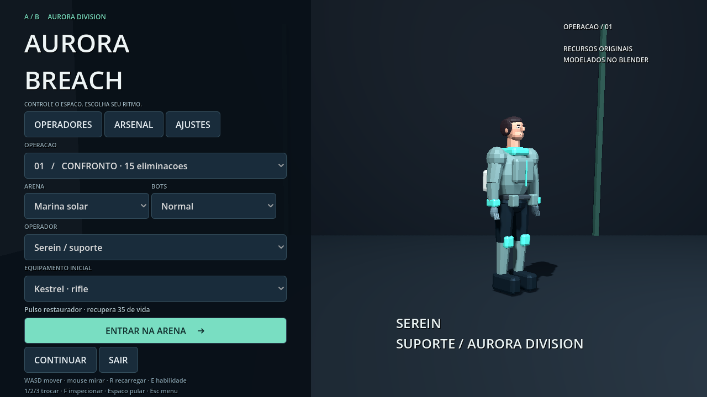

# Aurora Breach · FPS com modelos Blender

Novo projeto em [fps/](fps/README.md). Três armas, quatro operadores humanos estilizados, animações esqueléticas próprias, quatro mapas, quatro modos, minimapa e rodadas táticas com plantio e desarme. Download: aba Actions → **Aurora Breach FPS - Windows** → Artifacts → **Aurora-Breach-Windows**.

As versões anteriores VoxMateria e WordForge continuam preservadas abaixo.

---

# VoxMateria · nova versão Godot offline

O projeto solicitado no novo documento está em [godot/](godot/README.md): FPS voxel, extração de matéria, interpretação composicional sem API paga, física e ENet. Baixe o pacote no workflow **VoxMateria Godot offline - Windows**, na aba [Actions](https://github.com/vfeitosades-dot/wordforge-arena/actions).

Esta é uma versão vertical funcional. O escopo entregue e o que ainda falta estão documentados no README do Godot. A versão anterior WordForge e seu APK continuam abaixo e no workflow **Compilar jogo**.

---

# ✦ WordForge 3D

Mundo 3D em terceira pessoa, com visual simples de blocos, criações por voz ou texto e multiplayer entre PC e Android.

## Baixar e jogar

Na aba **Actions**, abra a execução concluída **Compilar jogo**. Em **Artifacts**, baixe **WordForge-Windows** e **WordForge-Android**. Extraia os ZIPs para obter `WordForge-3D-Windows.exe` e `WordForge-3D-Android.apk`. É necessário estar conectado ao GitHub; os arquivos ficam disponíveis por 90 dias. A compilação roda ao enviar código à branch main e também pode ser iniciada manualmente. Não publica releases automaticamente.

PC: Windows 10/11, 64 bits. Abra o EXE portátil. Android: versão 8+, WebView atualizado e suporte a WebGL 2. Instale o APK autorizando instalação pelo aplicativo usado para baixá-lo; jogue na horizontal.

**Jogar livre** abre um mundo local para criar e explorar. **Treinar** adiciona três bots de combate. **Multiplayer** entra em um mundo compartilhado. Partidas de combate vão até 10 eliminações e reiniciam após 7 segundos; retorno após morte em 2,5 segundos.

## Criar

Clique/toque no painel **CRIAR +** ou pressione Enter. Descreva o que deseja e clique em Criar; o botão de microfone também aceita uma frase. Exemplos:

- um dragão azul que me acompanha;
- um carro vermelho voador;
- um castelo de pedra;
- uma geladeira com asas;
- uma bazuca de patos;
- um buraco negro que atrai jogadores.

O seletor **Livre / Arma / Criatura / Veículo / Construção / Objeto** permite escolher a função. Qualquer descrição pode ser usada como arma: escolha Arma e descreva, por exemplo, uma banana, um dragão ou um castelo em miniatura.

Armas ficam equipadas. Veículos podem ser dirigidos; criaturas acompanham ou atacam conforme o comportamento gerado; construções têm colisão e partes destrutíveis. Outros comportamentos disponíveis: flutuar, saltitar, atrair, explodir, curar e proteger. Até 14 criações por jogador e 48 objetos simultâneos no mundo, incluindo o cenário. A criação mais antiga é removida quando necessário. **Limpar minhas criações** remove seus objetos.

## IA: descrições abertas e limites reais

Em **Inteligência artificial**, informe uma chave OpenAI e um modelo compatível com Chat Completions e saída JSON (padrão: gpt-4.1-mini). A chave fica somente na memória desta sessão e é enviada diretamente à API da OpenAI; nunca aos outros jogadores. Pode haver custo de API.

A IA online interpreta a descrição completa e compõe uma nova construção 3D com formas, posições, cores e proporções. Não está limitada a uma lista fechada de nomes de objetos. Novidades, misturas e conceitos inventados podem receber uma representação visual aproximada.

**Não é possível garantir literalmente qualquer coisa, aparência perfeita ou qualquer poder imaginável.** O jogo monta até 96 peças geométricas por criação e executa um conjunto finito de comportamentos. A IA aproxima pedidos que excedem essas possibilidades. Não gera malhas detalhadas, código arbitrário, sistemas completos ou simulações físicas ilimitadas.

Sem chave, funciona um **gerador procedural local com vocabulário limitado**. Ele reconhece algumas famílias de criaturas, veículos, construções, alimentos, objetos cósmicos e armas. Descrições desconhecidas geram uma escultura determinística própria; isso não equivale a compreensão semântica universal. Para interpretar pedidos amplos com mais fidelidade, use a IA online.

Se houver OPENAI_API_KEY no ambiente do servidor, a sala também poderá usar essa IA sem que visitantes informem uma chave. OPENAI_MODEL seleciona o modelo. Falhas da IA do servidor são informadas e usam geração local como alternativa. Uma chave digitada no app usa a IA do próprio jogador e comunica apenas o objeto pronto à sala.

## Controles

PC: WASD/setas movem. Clique na cena captura o mouse; mova para olhar e clique para atirar. Esc libera o mouse; também é possível arrastar o botão direito para olhar. Ctrl também atira. Espaço pula; E entra/sai de um veículo próximo. Em veículo voador, Espaço sobe e Shift desce. V abre voz; Enter abre criação.

Android: controle esquerdo move; controle direito e arrastar a cena giram a câmera. Botão ◎ atira, ↑ pula/sobe e E entra/sai. Ao editar uma descrição, os controles param para evitar ações involuntárias.

## Multiplayer PC + celular

1. Abra o EXE no PC anfitrião. Em Multiplayer, ele mostra um endereço como http://192.168.1.10:8787. O servidor inicia automaticamente na porta TCP 8787.
2. No anfitrião use http://localhost:8787. Nos outros aparelhos, use o endereço de rede do anfitrião.
3. Todos usam o mesmo código de sala. A primeira pessoa cria o mundo automaticamente. Até 8 jogadores por sala.
4. Mantenha o jogo anfitrião aberto. Permita acesso na rede privada quando o Windows solicitar. Use o mesmo Wi-Fi/LAN, sem isolamento de clientes.

Criações, veículos, posição, tiros, dano, partes destruídas e placar são sincronizados. O servidor valida e limita os objetos recebidos, sem executar código enviado pelos clientes.

Pela internet: hospede o servidor Node em endereço acessível e use HTTPS/WSS com proxy reverso, ou configure encaminhamento da porta TCP 8787 no roteador. Não há hospedagem pública permanente incluída. CGNAT pode impedir encaminhamento. Este protótipo não inclui contas, matchmaking, proteção contra abuso de produção nem persistência dos mundos.

Também funciona no navegador acessando o endereço do servidor, em dispositivos com WebGL 2. Voz no navegador exige suporte a SpeechRecognition e HTTPS ou localhost. Texto funciona em todos os clientes.

## Voz

Android usa o serviço de reconhecimento instalado no aparelho, podendo precisar de internet, português e permissão de microfone. O serviço de fala trata a gravação; o jogo recebe o texto.

Windows usa System.Speech via PowerShell. Prioriza um reconhecedor pt-BR instalado e usa outro idioma disponível como alternativa. O idioma disponível determina a precisão. Sem reconhecedor ou microfone, exibe uma mensagem e permite digitar.

O jogo não salva áudio nem o transmite aos jogadores. Os serviços externos de voz e de IA têm suas próprias políticas de tratamento de dados.

## Código e builds

Node.js 22+: `npm ci`, depois `npm run server`; abra http://localhost:8787. `npm start` abre o app desktop em desenvolvimento.

`npm run vendor` recompila a cópia local de Three.js. Ela já está incluída; o jogo não depende de uma CDN para renderizar.

Windows: `npm run build:win -- --publish never`. Saída: build/windows/WordForge-3D-Windows.exe. Portátil, sem certificado comercial.

Android: Java 21 e SDK Android, plataforma 35 e build-tools 35.0.0. Configure ANDROID_SDK_ROOT e rode `bash scripts/build-android.sh`. Saída: build/android/WordForge-3D-Android.apk. Não usa Gradle. Assinado para instalação direta, fora da Play Store.

A chave local é gerada em build/wordforge.keystore. Preserve-a para atualizações; não envie ao Git. WORDFORGE_KEYSTORE permite usar uma chave estável. As builds CI usam chaves novas e podem exigir desinstalar a versão anterior antes de instalar outra.

## Verificação e limites de teste

`npm test`: criação livre/local; conversão de qualquer assunto em arma; validação de saídas da IA; movimento 3D; salto; tiros contínuos; dano; retorno e vitória; dirigir/voar/sair; colisões; destruição; criaturas; limites; interpretação online com resposta simulada; dois clientes WebSocket; salas isoladas e desconexão.

A interface foi verificada em Chromium com renderização WebGL, mundo livre, criações, movimento, multiplayer entre duas janelas e controles em tamanho de celular. O APK é compilado e sua assinatura verificada; o EXE é gerado por electron-builder.

A execução do EXE em Windows, instalação do APK em aparelho real, desempenho em GPU móvel e um microfone físico ainda precisam de validação nos dispositivos finais. A integração com IA foi testada com resposta simulada; não havia chave de API disponível para uma chamada real neste ambiente.

Código próprio sob MIT. Three.js, Electron, Chromium e ws mantêm suas respectivas licenças. Os modelos visuais são construídos por código; não há cópia dos arquivos dos jogos usados como referência visual.
