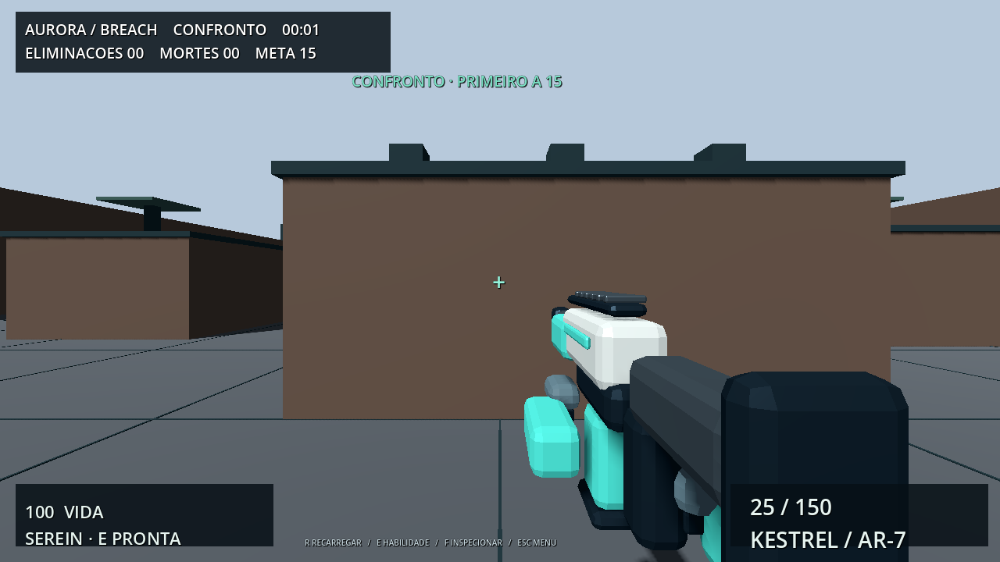

# Aurora Breach

FPS original em Godot 4.6.3 com recursos modelados e animados no Blender 4.3.2. Versão jogável solo com bots; não é um produto comercial completo nem uma reprodução de Valorant.

## Baixar

Abra Actions → Aurora Breach FPS - Windows → execução concluída → Artifacts → Aurora-Breach-Windows. Extraia o ZIP e execute AuroraBreach.exe. Não requer Godot instalado.

## Conteúdo

- 3 armas originais: Kestrel (rifle), Wisp (pistola) e Longbow (precisão).
- 3 operadores androides: Serein, Rook e Vesper, com cores, detalhes, apresentação e habilidades diferentes.
- Modelos com bevels, materiais, armatures, pesos e clipes importados de GLB. Idle, caminhada, corrida, salto, disparo, recarga, equipar, inspeção e habilidade. Os clipes de origem usam timeline de 24 fps, normalizada por speed_scale 2.5 no runtime para o ritmo pretendido de 60 fps. A recarga move carregador, mãos e mecanismo; não é apenas uma oscilação da câmera.
- Dois layouts próprios: Marina Solar e Observatório, com coberturas, rotas e marcadores visuais.
- Confronto (15 eliminações), sobrevivência (3 ondas) e estande de treino.
- Bots com A* por grade, linha de visão, tempo de reação, memória da última posição vista, perseguição, recuo e recarga. Não recebem posição-alvo através de paredes como informação de combate.
- Munição por arma, reserva, cancelamento de recarga ao trocar, dispersão ao mover, dano localizado na cabeça, proteção de reaparecimento e habilidades com cooldown.
- Menu com apresentação 3D, seleção de operador/arma/modo/mapa/dificuldade e ajustes de sensibilidade, FOV, volume, tela cheia e sombras. Resultado com precisão, mortes e headshots.

## Controles

WASD move; mouse olha; clique dispara; botão direito aproxima a mira; Shift corre; C agacha; Espaço pula; R recarrega; 1/2/3 trocam arma; F inspeciona; E usa habilidade; Esc abre/fecha menu.

Serein restaura 35 pontos de vida. Rook reduz dano por 5 segundos. Vesper recebe um impulso de movimento. Cooldown: 18 segundos.

## Modelos e animações

`art/Aurora_Source.blend.zip` contém o arquivo Blender com os seis modelos e suas ações. `art/build_assets.py` é o gerador reproduzível. `assets/*.glb` contém os modelos com esqueletos, pesos e animações exportados. Todos são próprios; nenhuma arma, personagem, textura, logotipo ou animação de Valorant foi copiada.

Para regenerar: `blender -b --python fps/art/build_assets.py`. A direção visual é de androides estilizados, com geometria simples e detalhes mecânicos; não se trata de personagens humanos realistas nem de animação cinematográfica feita por uma equipe de estúdio.

## Verificação

A suíte `tests/suite.gd` verifica os seis modelos, esqueletos, clipes e tracks, partes geométricas, rotas que evitam coberturas, colisão do jogador, consumo de munição, cancelamento de recarga, três habilidades, modos e pausa. A contagem de verificações de caminho depende dos trajetos amostrados.

O projeto foi aberto com renderização OpenGL por software para capturas reais do menu e da partida. A validação headless não substitui avaliação de qualidade de animação, desempenho em GPU real, áudio em alto-falantes ou testes prolongados com jogadores. O workflow compila e abre o EXE Windows antes de publicar. Os resultados efetivos ficam nos logs do GitHub.

## Limites

Este FPS é independente das versões VoxMateria e WordForge preservadas no repositório. Não inclui o sistema de criação por voz nem multiplayer do VoxMateria. Não inclui Android, campanha, matchmaking ou serviço online. Sons são procedurais básicos; mapas, modelos e animações são uma primeira passagem de arte original, com espaço para polimento. Não há garantia de ausência de bugs. Esses limites não são apresentados como recursos concluídos.

Código e recursos próprios: MIT, conforme LICENSE na raiz. Godot: MIT. As pesquisas e referências visuais estão em docs/RESEARCH.md.

