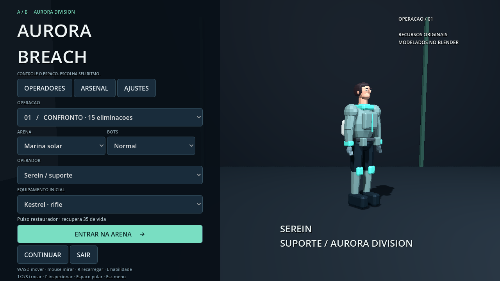
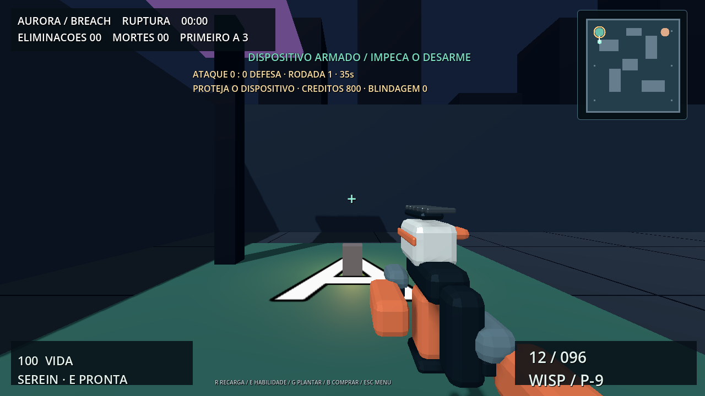
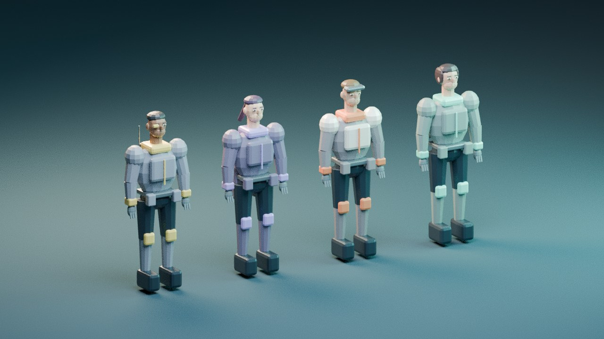

# Aurora Breach

FPS original em Godot 4.6.3 com recursos modelados e animados no Blender 4.3.2. Versão jogável solo com bots; não é um produto comercial completo nem uma reprodução de Valorant.

## Baixar

Abra Actions → Aurora Breach FPS - Windows → execução concluída → Artifacts → Aurora-Breach-Windows. Extraia o ZIP e execute AuroraBreach.exe. Não requer Godot instalado.

## Conteúdo

- 3 armas originais: Kestrel (rifle), Wisp (pistola) e Longbow (precisão).
- 4 operadores humanos estilizados: Serein, Rook, Vesper e Lumen, com cores, detalhes, apresentação e habilidades diferentes.
- Modelos com bevels, materiais, armatures, pesos e clipes importados de GLB. Idle, caminhada, corrida, salto, disparo, recarga, equipar, inspeção e habilidade. Os personagens incluem ainda mira, strafes, movimento para trás, agachamento, reação e queda. A árvore de animação combina locomoção das pernas e ações do tronco; tiro e recarga não interrompem as pernas. Os clipes de origem usam timeline de 24 fps, normalizada por speed_scale 2.5 no runtime para o ritmo pretendido de 60 fps. A recarga move carregador, mãos e mecanismo; não é apenas uma oscilação da câmera.
- Quatro layouts próprios: Marina Solar, Estação Boreal, Doca Neon e Complexo Verdant, com coberturas, rotas e marcadores visuais.
- Confronto (15 eliminações), sobrevivência (3 ondas), estande de treino e Ruptura (rodadas de ataque, compra, plantio e desarme).
- Bots com A* por grade, linha de visão, tempo de reação, memória da última posição vista, perseguição, recuo e recarga. Não recebem posição-alvo através de paredes como informação de combate.
- Munição por arma, reserva, cancelamento de recarga ao trocar, dispersão ao mover, dano localizado na cabeça, proteção de reaparecimento e habilidades com cooldown.
- Menu com apresentação 3D, seleção de operador/arma/modo/mapa/dificuldade e ajustes persistentes de sensibilidade, FOV, volume, sombras, redução de movimento, arma à esquerda e cor da mira, além de tela cheia e restauração dos padrões. HUD e menu adaptam-se a 16:9 e ultrawide. Resultado com precisão, mortes e headshots.

## Controles

WASD move; mouse olha; clique dispara; botão direito aproxima a mira; Shift corre; C agacha; Espaço pula; R recarrega; 1/2/3 trocam arma; F inspeciona; E usa habilidade; Esc abre/fecha menu.

Serein restaura 35 pontos de vida. Rook reduz dano por 5 segundos. Vesper recebe um impulso de movimento. Lumen revela os contatos no minimapa por 5 segundos. Cooldown: 18 segundos.

## Modelos e animações

O download **Aurora-Blender-Source** no mesmo workflow contém `Aurora_Source.blend.zip`, com quatro personagens articulados, três armas e suas ações editáveis. `art/build_assets.py` regenera os recursos com Blender 4.3.2. Os modelos de arma em terceira pessoa excluem os braços da primeira pessoa e seguem um socket na mão; malhas são agrupadas por material mantendo pesos.

Ao baixar o código, execute **`python fps/art/prepare_assets.py` antes de abrir `fps/project.godot` no Godot 4.6.3**. A preparação restaura sete GLBs e o ZIP Blender a partir dos pacotes comprimidos versionados, conferindo SHA-256. O workflow faz isso automaticamente. O EXE pronto não precisa de Python, Blender ou Godot instalado.

Para regenerar com Blender: `blender -b --python fps/art/build_assets.py`. São modelos estilizados de baixa complexidade, com faces, roupas, cabelo, dedos e acessórios próprios. Nenhuma arma, personagem, textura, logotipo ou animação de Valorant foi copiada. Não incluem escultura realista, IK completo ou animação cinematográfica de estúdio.

## Verificação

A suíte `tests/suite.gd` verifica os sete modelos animados e os três modelos de arma para terceira pessoa, esqueletos, clipes e tracks, partes geométricas, camadas simultâneas de recarga e locomoção, socket da arma, restauração de preferências, reaparecimento preservado na pausa, rotas que evitam coberturas, colisão do jogador, consumo de munição, cancelamento de recarga, quatro habilidades, modos e pausa. A contagem de verificações de caminho depende dos trajetos amostrados.

O projeto foi aberto com renderização OpenGL por software para capturas reais do menu e da partida. A validação headless não substitui avaliação de qualidade de animação, desempenho em GPU real, áudio em alto-falantes ou testes prolongados com jogadores. O workflow compila e abre o EXE Windows antes de publicar. Os resultados efetivos ficam nos logs do GitHub.

## Limites

Este FPS é independente das versões VoxMateria e WordForge preservadas no repositório. Não inclui o sistema de criação por voz nem multiplayer do VoxMateria. Não inclui Android, campanha, matchmaking ou serviço online. Sons são procedurais básicos; mapas, modelos e animações são arte original simples, com espaço para polimento. Os clipes de agachamento e reação estão no recurso editável, mas os bots não possuem um sistema tático de agachamento ou reação física a impactos. Não há garantia de ausência de bugs. Esses limites não são apresentados como recursos concluídos.

Código e recursos próprios: MIT, conforme LICENSE na raiz. Godot: MIT. As pesquisas e referências visuais estão em docs/RESEARCH.md.

Auditoria, comparação e limites das medições: [docs/POLISH_QA.md](docs/POLISH_QA.md).

## Atualização Ruptura

Modo tático **solo, atacante contra quatro bots defensores**; não é multiplayer 5v5. Primeiro lado a três rodadas vence. Cada rodada tem 8 segundos de preparação e 90 segundos para atacar. O jogador começa com pistola e 800 créditos, recebe 200 por eliminação e 1000/600 por vitória/derrota de rodada. A loja B vende Kestrel (1000), Longbow (1400) e blindagem (350). Comprar outra arma substitui a primária da rodada; não há reembolso.

Aproxime-se de A ou B, pare e segure G por 2,5 segundos. Soltar ou mover cancela o plantio. Não é possível atirar ou usar habilidade enquanto planta. Após armar, proteja o dispositivo por 35 segundos. Defensores próximos precisam de quatro segundos contínuos para desarmá-lo e interrompem combate durante a interação. Morrer antes de plantar perde a rodada; após plantar, o dispositivo ainda pode vencer. O mapa é mantido e entidades/recursos de rodada são reinicializados corretamente.

O minimapa mostra coberturas, A/B, jogador e somente adversários com linha de visão desobstruída; não revela inimigos através de paredes. Quatro temas têm layouts e materiais próprios: solar, alpino, porto noturno e botânico. As decorações ficam sobre as coberturas; pilares e bordas também são considerados pela grade de navegação.

Foram acrescentados testes de economia, compra bloqueada, dano em blindagem, plantio fora do ponto, cancelamento, desarme interrompido, transição de rodada, vitória por explosão após morte, encerramento da partida, restrição de armas não compradas, bloqueio de disparo/habilidade durante plantio e restauração correta ao sair do menu. Os resultados efetivos estão no workflow e no relatório de testes. Não há validação de multiplayer 5v5 nesta versão.
